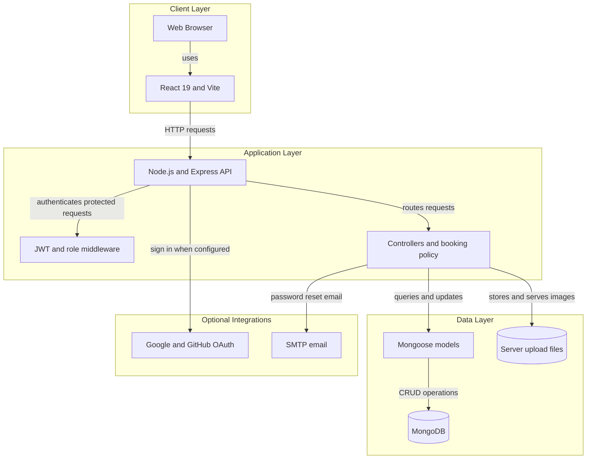
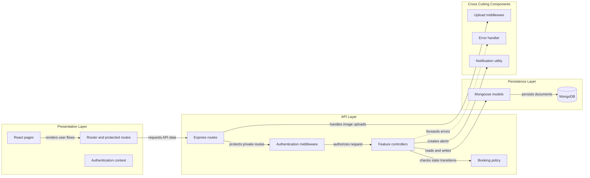

# Architecture Diagram

TrustHub is a React and Express web application backed by MongoDB. The diagrams summarize the deployed application layers and the principal interactions between frontend, API, and persistence components.

## Application Architecture

<!-- mermaid-checked: no \n, no em-dash/en-dash, no {} in labels, subgraphs are id["label"], arrows are -->|"label"|, all subgraphs closed by end, ids unique -->

### Technology Stack Summary

| Layer | Technology | Version | Purpose |
|---|---|---:|---|
| Client | React | 19 | User interface and role-specific experiences |
| Client tooling | Vite | 8 | Development server and production build |
| API | Node.js | 20.19+ or 22.12+ | JavaScript runtime |
| API framework | Express | 4 | REST endpoints and middleware |
| Data access | Mongoose | 8 | MongoDB models and validation |
| Database | MongoDB | Not specified | Persistent application data |
| Authentication | JWT and bcryptjs | Package versions in manifests | Authenticated sessions and password hashing |

### Data Storage & External Services

MongoDB stores users, provider profiles, service listings, bookings, reviews, messages, notifications, and flagged activities. Uploaded booking images are served from server-side upload storage. Google/GitHub OAuth and SMTP email are optional integrations that require deployment-specific credentials and callback/configuration.

### Key Architectural Decisions

- The application separates the React client from the Express API.
- Backend routes, controllers, Mongoose models, middleware, and utilities are organized by responsibility.
- Customer, provider, and administrator access is protected by authentication, role checks, and resource ownership rules.

## Component Relationships

<!-- mermaid-checked: no \n, no em-dash/en-dash, no {} in labels, subgraphs are id["label"], arrows are -->|"label"|, all subgraphs closed by end, ids unique -->

### Component Inventory

| Component | Layer | Type | Responsibility |
|---|---|---|---|
| React pages | Presentation | Pages | Render public and role-specific workflows |
| Router and protected routes | Presentation | Routing | Map URLs to pages and restrict frontend routes by role |
| Authentication context | Presentation | State context | Provide the active user/session to client pages |
| Express routes | API | Routes | Map HTTP paths to controller operations |
| Authentication middleware | API | Middleware | Authenticate requests and enforce access roles |
| Feature controllers | API | Controllers | Validate requests and apply feature behavior |
| Booking policy | API | Utility | Validate booking transitions, appointment details, and payment amount rules |
| Mongoose models | Persistence | Data models | Define document schemas, references, and validation |
| MongoDB | Persistence | Database | Store application records |
| Notification utility | Cross-cutting | Utility | Create notifications for application events |
| Upload middleware | Cross-cutting | Middleware | Accept and store uploaded images |
| Error handler | Cross-cutting | Middleware | Convert propagated errors into API responses |
